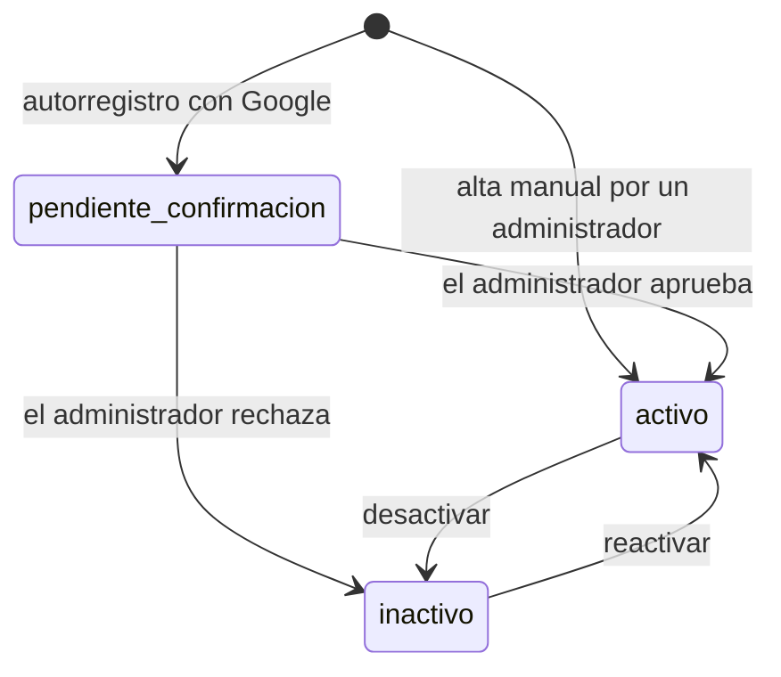
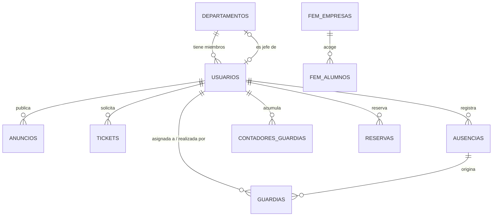

# Modelo de datos de la intranet

La intranet guarda sus datos en **MongoDB** (base de datos `intranet`) y usa **Redis** como complemento para datos temporales. Este documento describe el esquema inicial: las colecciones ya implementadas y las previstas para las siguientes fases.

## Criterios de diseño

- **Una colección por entidad** del contrato OpenAPI. Los nombres de colecciones y campos van en español y en `snake_case`, igual que en la API.
- **Referencias por identificador** (`ObjectId`) entre colecciones. Los nombres que la API devuelve junto a un identificador (por ejemplo `departamento_nombre`) **no se guardan duplicados**: se resuelven al leer. Así un cambio de nombre no deja datos desactualizados.
- **Documentos embebidos** solo cuando el dato no tiene vida propia fuera de su padre (por ejemplo, los pupitres de una disposición de aula).
- **Fechas en UTC**. MongoDB las guarda con precisión de milisegundos.
- **Las reglas de unicidad se garantizan con índices únicos**, no solo con comprobaciones en el código.
- **Parámetros configurables fuera del código** (por ejemplo, el umbral de retrasos del dashboard) en la colección `configuracion`.

## Colecciones implementadas (Fase 1)

### `usuarios`

| Campo | Tipo | Obligatorio | Descripción |
|---|---|---|---|
| `_id` | ObjectId | sí | Identificador. En la API se expone como `id`. |
| `email` | string | sí | Correo en minúsculas. **Único.** |
| `nombre` | string | sí | |
| `apellidos` | string | sí | |
| `telefono` | string \| null | no | |
| `foto_url` | string \| null | no | |
| `biografia` | string \| null | no | |
| `departamento_id` | ObjectId \| null | no | Referencia a `departamentos`. |
| `roles` | array de string | sí | Uno o varios de: `profesor`, `administrador`, `jefatura_estudios`, `secretaria`, `responsable_rmi`, `admin_rrss`, `direccion`. |
| `estado` | string | sí | `activo`, `inactivo` o `pendiente_confirmacion`. |
| `google_id` | string | no | Identificador de la cuenta de Google. Solo existe cuando el usuario ya ha entrado con Google. **Único.** |
| `fecha_creacion` | fecha | sí | |
| `ultimo_acceso` | fecha \| null | no | Último inicio de sesión. |

Índices: `email` (único) y `google_id` (único y *sparse*: solo se aplica a los documentos que tienen el campo).

Estados de una cuenta:

Una cuenta nunca vuelve a `pendiente_confirmacion`. Un administrador no puede desactivar, eliminar ni quitar el rol de administrador a su propia cuenta.

### `departamentos`

| Campo | Tipo | Obligatorio | Descripción |
|---|---|---|---|
| `_id` | ObjectId | sí | |
| `codigo` | string | sí | Código en mayúsculas, por ejemplo `DEP-INF`. **Único.** |
| `nombre` | string | sí | |
| `descripcion` | string | no | |
| `jefe_departamento_id` | ObjectId \| null | no | Referencia a `usuarios`. |

El número de miembros (`miembros_count` en la API) se calcula contando los usuarios del departamento; no se guarda.

### Redis

| Clave | Valor | Caducidad | Uso |
|---|---|---|---|
| `refresh_revocado:<jti>` | `1` | Lo que le quedaba de vida al token | Refresh tokens que ya no se aceptan: usados en una renovación o cerrados con *logout*. |

Redis no guarda ningún dato que no pueda perderse: si se vacía, lo único que ocurre es que un refresh token revocado volvería a ser válido hasta su caducidad natural (7 días).

## Colecciones previstas

Se crearán en la fase en la que se desarrolla cada módulo, siguiendo los esquemas del contrato (`docs/api/openapi-intranet.yaml`).

| Fase | Colección | Contenido | Decisiones de diseño |
|---|---|---|---|
| 2 | `anuncios` | Tablón: título, cuerpo, autor, ámbito (general, departamental o curso), destacado, caducidad | Los caducados no se borran: se filtran por fecha al consultar. |
| 2 | `tickets` | Solicitudes de RMI, compras y RRSS | **Una sola colección** para los tres tipos, con `tipo`, `estado` (`pendiente` → `en_curso` → `finalizado`) y `datos_especificos` como objeto flexible. |
| 2 | `publicaciones_rrss` | Borrador generado con IA, imágenes y ticket asociado | |
| 2 | `fem_empresas`, `fem_alumnos` | Empresas colaboradoras con coordenadas; seguimiento de horas sobre 500 | El porcentaje de progreso se calcula, no se guarda. |
| 2 | `retrasos` | Retraso de un alumno: fecha, hora y módulo | Las estadísticas se calculan solo para el dashboard. |
| 2 | `aulas` | Aulas y sus disposiciones de pupitres | Las disposiciones van embebidas en el aula. |
| 2 | `onboarding_pasos`, `onboarding_videos` | Guía de primeros pasos | |
| 2 | `auditoria` | Usuario, acción y fecha de cada acción relevante | Solo se añade; nunca se modifica ni se borra. |
| 3 | `horarios` | Horario semanal de cada docente, con reducciones como bloques de no disponibilidad | |
| 3 | `guardias` | Guardias por hueco horario | Distingue `docente_asignado_id` (a quien le toca por ronda) de `docente_que_realiza_id` (quien la cubre). |
| 3 | `contadores_guardias` | Guardias realizadas por docente **y hueco horario** | Base del algoritmo de rondas: la comparación es siempre dentro del mismo hueco. |
| 3 | `ausencias` | Ausencias con su tipo, justificante, PDF y firma | Máquina de estados compartida con `comisiones`. |
| 3 | `comisiones` | Comisiones de servicio, con PDF y firma | |
| 3 | `derivaciones_convivencia` | Alumnos derivados al aula de convivencia y trabajo asignado | |
| 3 | `documentos`, `espacios`, `recursos`, `reservas` | Repositorio documental y reservas | El solapamiento de reservas se comprueba al crear y responde `409`. |
| 4 | `notificaciones`, `suscripciones_push` | Avisos y suscripciones Web Push | |
| 4 | `rgpd_consentimientos`, `rgpd_solicitudes`, `accesos_sensibles` | Consentimientos, derechos y trazabilidad de accesos a datos de menores | |
| — | `configuracion` | Parámetros del centro (umbral de retrasos, etc.) | Un documento por parámetro. |

Pendiente de decidir al empezar la Fase 2: si los alumnos tienen colección propia o se identifican solo dentro de los módulos que los usan (retrasos, convivencia y FEM).

## Relaciones principales

## Web pública

La web pública usa otra base de datos (MySQL/MariaDB), totalmente independiente de esta. Su modelo relacional se documentará junto con su script SQL en `web-publica/database/`.
